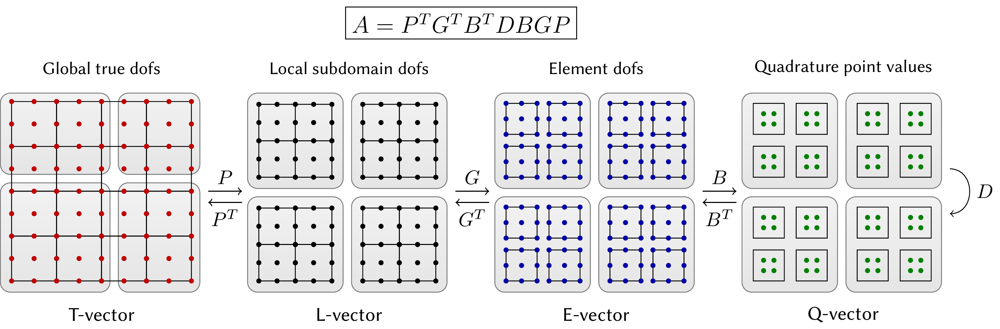

<script type="text/x-mathjax-config">
  MathJax.Hub.Config({tex2jax: {inlineMath: [['$','$']]}});
</script>
<script type="text/javascript"
  src="https://cdnjs.cloudflare.com/ajax/libs/mathjax/2.7.2/MathJax.js?config=TeX-AMS_HTML">
</script>

<!-- Interactive map between the weak form and the code, and the interactive
     operator decomposition further down. Loaded here rather than site-wide,
     so no other page pays for them. -->
<link rel="stylesheet" href="css/dfem-map.css">
<script type="text/javascript" src="js/dfem-map.js"></script>
<link rel="stylesheet" href="css/dfem-diagram.css">
<link rel="stylesheet" href="css/dfem-page.css">
<script type="text/javascript" src="js/dfem-diagram.js"></script>

# Differentiable Finite Elements (∂FEM)

∂FEM brings differentiability into MFEM's high-performance finite element framework. 
It makes it possible to compute derivatives with respect to the solution or to any parameter field, which sensitivity analysis, PDE-constrained optimization, inverse problems and topology optimization all require.

This page explains the main concepts. For a brief guide on how to implement common tasks, please refer to the
[∂FEM HowTo](../howto/dfem.md), and for complete working examples, see [miniapps](#miniapps-and-tests).

<div class="panel panel-warning">
<div class="panel-heading">
<h3 class="panel-title"><i class="fa fa-exclamation-triangle"></i>&nbsp; Development branch</h3>
</div>
<div class="panel-body">
This page documents the
<a href="https://github.com/mfem/mfem/tree/dfem-dev"><code>dfem-dev</code></a>
branch of MFEM, which is in active development and being reviewed for merging
into <code>master</code>. The ∂FEM code currently on <code>master</code> is an
older version and does not match this page. ∂FEM lives in the
<code>mfem::future</code> namespace, and its interface may still change. See
<a href="#current-limitations">Current limitations</a> for what is not supported
yet.
</div>
</div>

## Overview

When applied as a black box around a whole program, automatic differentiation (AD) has to see through complicated program structures, non-trivial object types and communication layers such as MPI, often making it an impractical choice.

∂FEM instead **constrains AD to the quadrature point level**. You write the physics as a function evaluated at a single quadrature point, and MFEM derives the rest: the operator action, its Jacobian, the transpose of that Jacobian, assembled matrices, and, for scalar functionals, the gradient and the Hessian.

MFEM writes a finite element operator in the [finite element operator decomposition](../performance.md#finite-element-operator-decomposition):

$$ A_p(u) \;=\; P^{\sf T} G^{\sf T} B^{\sf T} \; D\big(B \, G \, P \, u\big), $$

where $P$ and $G$ take the solution from global true degrees of freedom down to
element degrees of freedom, $B$ evaluates it at the quadrature points, and $D$
applies the pointwise physics there:

 

The key observation is that $P$, $G$ and $B$ are **linear** and **topological**
and depend only on the mesh and the finite element spaces, not on the solution,
the coordinates, or any design parameter. Therefore we can exclude them from
differentiation, and write the Jacobian of the whole operator using the same
decomposition:

$$ J_p(u) \;=\; P^{\sf T} G^{\sf T} B^{\sf T} \; J_D(u_q) \; B \, G \, P, $$

where $D$ is the only part a user specifies, and the only part to be
differentiated.

The same holds for **parameters**. A parametric operator $A(u;\rho)$ takes its
design or coefficient fields through their own prolongation,
$\hat\rho = B_\rho G_\rho P_\rho \, \rho$, so in the API a parameter is just
another field, and differentiating with respect to a design field
is the very same call as differentiating with respect to the solution.

### AD tools: Enzyme and dual numbers

Derivatives at the quadrature points are computed with one of two automatic differentiation tools, chosen when MFEM is configured:

- **[Enzyme](https://enzyme.mit.edu)**: a compiler plugin that
  differentiates at the LLVM IR level, after optimization, in forward and
  reverse mode, including on GPU kernels. Working at the IR level lets it
  differentiate across languages (C, C++, Julia, Rust, Fortran), so a q-function
  may call external code written in another language, as long at it lowers to IR.
- **Dual numbers**, `dual<real_t, real_t>`: header-only forward mode
  by operator overloading, used when MFEM is built without Enzyme. It has no
  external dependencies and debugs easily, which is convenient while developing
  a new q-function. Only code written against the dual type is differentiated,
  so a q-function cannot call into external code.

| | Enzyme | Dual numbers |
| --- | --- | --- |
| Enabled by | `MFEM_USE_ENZYME=YES` | default |
| Compiler | `clang++` matching the Enzyme plugin | any C++17 compiler |
| Scalar type of differentiated arguments | `real_t` | `dual<real_t, real_t>` |
| Jacobians, transposes, assembly | yes | yes |
| Functionals and second derivatives | yes | yes (nested dual numbers) |
| Differentiate external code | yes | no |

The two differ only in the scalar type the differentiated arguments of your
q-function are written against, so one alias covers both:

```c++
using dscalar_t = std::conditional_t<mfem::UseEnzyme, real_t,
                                     mfem::future::dual<real_t, real_t>>;
```

## Building MFEM with ∂FEM

∂FEM needs a parallel build of MFEM. Enzyme is a plugin for LLVM, so MFEM must
be compiled with `clang++` from the same LLVM that Enzyme was built with.
Without Enzyme, ∂FEM uses dual numbers and any C++17 compiler works.

The main requirements are:

| | With Enzyme | With dual numbers |
| --- | --- | --- |
| MPI | `MFEM_USE_MPI=YES` | `MFEM_USE_MPI=YES` |
| Enzyme | v0.0.304 or later, `MFEM_USE_ENZYME=YES` | — |
| Compiler | `clang++`, from the LLVM Enzyme was built with (18 or later) | any C++17 compiler |
| GPU | CUDA: `CUDA_CXX=clang++`; HIP: `HIP_CXX=clang++` | any CUDA or HIP setup MFEM supports |

With Enzyme, configure MFEM with that `clang++`. With GNU make, in
`config/user.mk`:

```make
MFEM_USE_MPI    = YES
MFEM_USE_ENZYME = YES
ENZYME_DIR      = /path/to/enzyme
CXX             = clang++
MPICXX          = OMPI_CXX=$(CXX) mpicxx    # MPICH: MPICH_CXX=$(CXX) mpicxx
```

or with CMake:

```sh
cmake .. -DCMAKE_CXX_COMPILER=clang++ -DMFEM_USE_MPI=ON \
         -DMFEM_USE_ENZYME=ON -DENZYME_DIR=/path/to/enzyme
```

More details on how to build Enzyme on Linux and macOS. are provided in [INSTALL](https://github.com/mfem/mfem/blob/dfem-dev/INSTALL).

## Building a DifferentiableOperator

The core of ∂FEM is the `DifferentiableOperator` class. Like a `BilinearForm`, you *construct it on a mesh*, *add integrators to it*, and *apply it*. The difference is that the physics is provided by the user as a custom quadrature-point function, which ∂FEM then differentiates.

Building the operator involves three components:

- [**Field descriptors**](#field-descriptors): which space each field lives in, under an integer ID you choose.
- [**Field operators**](#field-operators): how each field is evaluated at a quadrature point (`Inputs<...>`), and which test functions the results are contracted against (`Outputs<...>`).
- [**q-function**](#q-functions): the physics at one quadrature point, the only part that is differentiated.


### Field descriptors

A `FieldDescriptor` describes a field by its ID, a distinct non-negative integer known at compile time, and the space it lives in, as in `{U, &fes}`:

```c++
constexpr int U = 0, Coords = 1;
pmesh.EnsureNodes();
auto *nodes = static_cast<ParGridFunction *>(pmesh.GetNodes());
auto *mesh_nodes_fes = nodes->ParFESpace();
std::vector<FieldDescriptor> inputs = {{U, &fes}, {Coords, mesh_nodes_fes}};
```

| Space | Used for |
| --- | --- |
| `ParFiniteElementSpace` (H1, L2) | the solution, coefficient fields, the mesh nodes |
| `VectorQuadratureSpace` | data stored at the quadrature points, functional outputs |
| `ParameterSpace` (derived by the user) | parameters with a layout of their own |

The mesh coordinates are a field like any other, declared on the space of the mesh nodes (the `ParFiniteElementSpace` of `pmesh.GetNodes()`, after `pmesh.EnsureNodes()`).
This enables straightforward differentiation with respect to the mesh shape.

### Field operators

Field operators are the $B/B^T$ of the FE decomposition. The same operators are
used on both sides of the q-function, with two different meanings:

$$ \int_\Omega \underbrace{D\big(\overbrace{u,\ \nabla u}^{\texttt{Inputs}}\big)}_{\text{q-function}}
   \cdot \overbrace{\nabla v}^{\texttt{Outputs}} \; dx $$

- `Inputs<...>`: what the q-function receives, e.g. `Value<U>` interpolates $u$ at qp,
  `Gradient<U>` $\nabla u$;
- `Outputs<...>`: which test function the result is tested against, e.g.
  `Value<U>` gives $v$, `Gradient<U>` gives $\nabla v$.

| Field operator | At a quadrature point | Q-function argument | Use |
| --- | --- | --- | --- |
| `Value<ID>` | the interpolated value | `scalar_t`, `tensor<scalar_t, V>` | In, Out |
| `Gradient<ID>` | the gradient, in **reference** coordinates | `tensor<scalar_t, D>`, `tensor<scalar_t, V, D>` | In, Out |
| `Identity<ID>` | the data as is, for a `VectorQuadratureSpace` field | `scalar_t`, `tensor<scalar_t, ...>` | In, Out |
| `Weight` | the integration rule weight (no field ID) | `real_t` | In |
| `Orientation` | the orientation sign of a boundary face, $\pm 1$ (no field ID) | `real_t` | In (boundary) |
| `FunctionalValue<ID>` | the integrand of a scalar functional | `scalar_t` | Out |

For the **q-function argument** `V` is the vector dimension of the field, `D` the reference dimension (one less
on the boundary).

<div class="panel panel-info">
<div class="panel-heading">
<h3 class="panel-title"><i class="fa fa-info-circle"></i>&nbsp; Note</h3>
</div>
<div class="panel-body">
Gradients arrive in reference coordinates $\xi$, so the q-function maps them to
physical coordinates itself, with the Jacobian $J = \partial x / \partial \xi$ of
the mesh coordinates (<code>Gradient&lt;Coords&gt;</code>) and the quadrature
weight $w$ (<code>Weight</code>):
$$ \nabla_{\!x} u = \nabla_{\!\xi} u \; J^{-1}, \qquad
   \int_\Omega f \, dx \;\approx\; \sum_q f(x_q) \, \det(J_q) \, w_q . $$
</div>
</div>

### Q-functions

The q-function is a functor describing the physics at the quadrature point level, and the only part that gets differentiated.

For a mass term $\int_\Omega u \, v \, dx$:

```c++
struct Mass
{
   MFEM_HOST_DEVICE inline
   void operator()(const dscalar_t &u,                 // Inputs:  Value<U>
                   const tensor<real_t, dim, dim> &J,  //          Gradient<Coords>
                   const real_t &w,                    //          Weight
                   dscalar_t &v) const                 // Outputs: Value<U>
   {
      v = u * det(J) * w;
   }
};
```

Some requirements for the q-function:

| | |
| --- | --- |
| **Form** | be a functor with a `const` call operator, or a lambda |
| **Signature** | take the inputs, then the outputs (non-const references), each in declaration order, and return `void` |
| **Types** | follow the [field operator table](#field-operators), with `dscalar_t` where differentiated |
| **GPU** | be marked `MFEM_HOST_DEVICE` |
| **Geometry** | apply `Weight` and `Gradient<Coords>` itself, as above |
| **State** | not rely on members changed after registration: it is copied; pass such data as a field |

### Creating the operator

A `DifferentiableOperator` is built from two vectors of `FieldDescriptor`, its
input and output fields, and a `ParMesh`:

```c++
DifferentiableOperator(
   const std::vector<FieldDescriptor> &infds,   // input fields
   const std::vector<FieldDescriptor> &outfds,  // output fields
   const ParMesh &mesh);
```

### Adding an integrator

Integrators are then registered on that operator:

```c++
template <typename backend_t = LocalQFBackend,
          DerivativeKernels kernels = DerivativeKernels::All, ...>
void AddDomainIntegrator(   // or AddBoundaryIntegrator
   qfunc_t &qfunc,                             // 1. q-function functor
   input_t inputs,                             // 2. Inputs<...>  field operators
   output_t outputs,                           //    Outputs<...> field operators
   const IntegrationRule &integration_rule,    // 3. Integration rule
   const Array<int> &attributes,               // 4. Attributes
   derivative_ids_t derivative_ids = {},       // 5. Derivatives<...>
   second_derivative_ids_t second_derivative_ids = {}); //  SecondDerivatives<...>
```

so what has to be provided is:

1. The functor for the q-function,
2. Two tuples of `FieldOperator`s, associated to the operator's `FieldDescriptor`s,
3. An `IntegrationRule`, on the element geometry for a domain integrator and
   on the face geometry for a boundary one,
4. An attribute marker array: domain attributes for `AddDomainIntegrator`,
   boundary attributes for `AddBoundaryIntegrator`,
5. (optional) The field IDs to differentiate with respect to, and, for
   functionals, the [second derivatives](#functionals-and-second-derivatives).

The two template arguments select the backend, which fixes the type of
q-function and the execution model (see
[Local and global backends](#local-and-global-backends)), and the
[kernels](#reducing-compile-time-kernel-selection) generated for the
derivatives.

The `Derivatives<...>{}` sequence determines which derivatives are generated, at
**compile time**: only the requested ones are instantiated, so nothing is paid
for a derivative that is never asked for. Omit the unnecessary ones, or the
entire sequence for an operator you only ever apply and never differentiate;
even then ∂FEM is useful, since it lets you write custom physics without
implementing a new `BilinearFormIntegrator`.

### Example: nonlinear diffusion

This example puts the pieces together for a nonlinear diffusion residual
$\int_\Omega \kappa(u) \, \nabla u \cdot \nabla v \, dx$, with
$\kappa(u) = 1 + u^2$. Point at any coloured term below — in the maths or in
the code — to light up its counterparts:

<div id="dm">
<div id="dm-legend"></div>
<div id="dm-caption"></div>
<div id="dm-body">
<div class="dm-col dm-col-math">

<p class="dm-h">The weak form</p>
<div class="dm-math">
$$ r(u;v) \;=\; \class{dm-domain}{\int_\Omega} \class{dm-kappa}{\kappa(u)} \,
   \class{dm-gradu}{\nabla u} \cdot \class{dm-test}{\nabla v} \;
   \class{dm-measure}{dx} \;=\; 0 $$
</div>
<p class="dm-sub">for all $v \in V_h$, with $\class{dm-kappa}{\kappa(u) = 1 + u^2}$.</p>

<p class="dm-h">Evaluated at the quadrature points</p>
<div class="dm-math">
$$ \class{dm-domain}{\sum_q} \class{dm-kappa}{\kappa(u_q)} \,
   \class{dm-gradu}{\nabla_{\!x} u_q} \cdot \class{dm-test}{\nabla_{\!x} v_q} \;
   \class{dm-measure}{\det(J_q)\, w_q} $$
</div>
<p class="dm-sub">This line is the q-function, term for term.</p>

<p class="dm-h">The operator decomposition</p>
<div class="dm-math">
$$ A_p(u) \;=\; \class{dm-test}{P^{\sf T} G^{\sf T} B^{\sf T}} \;
   \class{dm-qf}{D}\big( \class{dm-evalB}{B \, G \, P} \, u \big) $$
</div>
<p class="dm-sub">$P$, $G$ and $B$ are topological, so only $\class{dm-qf}{D}$ is
written, and only $\class{dm-qf}{D}$ is differentiated.</p>

</div>
</div>
</div>

```c++
// Field identifiers — arbitrary integers, your names for the fields
constexpr int U = 1, Coords = 2, dim = 2;

// The q-function: the physics at a single quadrature point
struct NonlinearDiffusion
{
   MFEM_HOST_DEVICE inline
   void operator()(const dscalar_t &u,                 // Value<U>
                   const tensor<dscalar_t, dim> &dudxi, // Gradient<U>
                   const tensor<real_t, dim, dim> &J,  // Gradient<Coords>
                   const real_t &w,                    // Weight
                   tensor<dscalar_t, dim> &dvdxi) const // the output
   {
      const auto invJ = inv(J);
      const auto dudx = dudxi * invJ;             // physical gradient
      const auto kappa = 1.0_r + u * u;
      dvdxi = kappa * dudx * transpose(invJ) * det(J) * w;
   }
};

// The pieces the operator is built on
pmesh.EnsureNodes();
auto *nodes = static_cast<ParGridFunction *>(pmesh.GetNodes());
auto *mesh_nodes_fes = nodes->ParFESpace();
const IntegrationRule &ir = IntRules.Get(pmesh.GetTypicalElementGeometry(),
                                         2 * order + 1);
Array<int> all_domain_attr(pmesh.attributes.Max());
all_domain_attr = 1;

// Which spaces the fields live in
std::vector<FieldDescriptor> inputs  = {{U, &fes}, {Coords, mesh_nodes_fes}};
std::vector<FieldDescriptor> outputs = {{U, &fes}};

DifferentiableOperator dop(inputs, outputs, pmesh);

// Register the integrator. The backend argument fixes how many quadrature
// points the q-function sees per call — see "Local and global backends".
NonlinearDiffusion qf;
dop.AddDomainIntegrator<LocalQFBackend>(
   qf,
   Inputs<Value<U>, Gradient<U>, Gradient<Coords>, Weight> {},
   Outputs<Gradient<U>> {},
   ir, all_domain_attr,
   Derivatives<U> {});
```

The q-function above is written against a *single* quadrature point, the form
both backends accept (see [backends](#local-and-global-backends)).

### Multiple integrators and outputs

Several integrators may be added to one operator, and their contributions
**accumulate**, just like with the integrators of a `BilinearForm`. The same can
be achieved within a single integrator declared with **multiple outputs**:
outputs landing on the same field are summed after each has been contracted
with its own test function basis. This is how an operator that is a sum of
terms is written in one pass over the quadrature points, with the geometry
evaluated only once.

As an example, for a Helmholtz-type operator
$\int_\Omega \nabla u \cdot \nabla v \, dx - k^2 \int_\Omega u \, v \, dx$, the
diffusion term leaves through `Gradient<U>` and the mass term through
`Value<U>`:

```c++
struct Helmholtz
{
   real_t k;

   MFEM_HOST_DEVICE inline
   void operator()(const real_t &u,                      // Value<U>
                   const tensor<real_t, dim> &dudxi,     // Gradient<U>
                   const tensor<real_t, dim, dim> &J,    // Gradient<Coords>
                   const real_t &w,                      // Weight
                   real_t &mass,                         // out: Value<U>
                   tensor<real_t, dim> &diffusion) const // out: Gradient<U>
   {
      const auto invJ = inv(J);
      const auto detJ = det(J);
      mass      = -k * k * u * detJ * w;
      diffusion = (dudxi * invJ) * transpose(invJ) * (detJ * w);
   }
};

Helmholtz qf{k};
dop.AddDomainIntegrator<LocalQFBackend>(
   qf,
   Inputs<Value<U>, Gradient<U>, Gradient<Coords>, Weight> {},
   Outputs<Value<U>, Gradient<U>> {},
   ir, all_domain_attr,
   Derivatives<U> {});
```

This effectively evaluates, in one sweep over the quadrature points,

$$ y \;=\; P^{\sf T} G^{\sf T} \Big( B_{\text{val}}^{\sf T} \, D_{\text{mass}}
   \;+\; B_{\text{grad}}^{\sf T} \, D_{\text{diff}} \Big)\big(B \, G \, P \, u\big), $$

where $B = [\,B_{\text{val}};\ B_{\text{grad}}\,]$ stacks the two interpolations requested in `Inputs`, so that $B \, G \, P \, u$ carries both the value and the
reference gradient of $u$ at every quadrature point, and $B^{\sf T}$ splits into
one transposed interpolation per declared output.

This is the matrix-free action $y = (A - k^2 M)\,u$, with neither the stiffness matrix $A$ nor the mass matrix $M$ ever being formed, and it gives access to the Jacobian of the combined operator.


### Multiple fields

An operator can couple several fields. Each field has its own
`FieldDescriptor`, and the operator's output has one block per output field, in
descriptor order. For Stokes, the momentum residual is tested against $v$ and
the continuity residual against $q$:

```c++
constexpr int U = 0, P = 1, Coords = 2;

std::vector<FieldDescriptor> inputs  = {{U, &u_fes}, {P, &p_fes}, {Coords, mesh_nodes_fes}};
std::vector<FieldDescriptor> outputs = {{U, &u_fes}, {P, &p_fes}};
DifferentiableOperator dop(inputs, outputs, pmesh);

dop.AddDomainIntegrator<LocalQFBackend>(
   qf,
   Inputs<Gradient<U>, Value<P>, Gradient<Coords>, Weight> {},
   Outputs<Gradient<U>, Value<P>> {},   // momentum, continuity
   ir, all_domain_attr,
   Derivatives<U, P> {});
```

The Jacobian has one block per (output, input) pair:

|              | $\partial / \partial U$ | $\partial / \partial P$ |
|--------------|---------------------------|---------------------------|
| **Output U** | $\partial R_U / \partial U$ | $\partial R_U / \partial P$ |
| **Output P** | $\partial R_P / \partial U$ | $\partial R_P / \partial P$ |

`GetDerivative(U, X)` returns the first column and `GetDerivative(P, X)` the
second, each with one row block per output field (see
[assembly](#assembled-matrices-and-diagonals)).

### Functionals and second derivatives

When the physics is naturally a scalar functional $F$ rather than a residual,
writing the functional alone is enough: ∂FEM derives its gradient and its
Hessian. Take a parametrized Dirichlet energy over a solution $u$ and a
coefficient field $\rho$,

$$ F(u;\rho) \;=\; \int_\Omega \tfrac{1}{2}\, \rho \, |\nabla u|^2 \, dx. $$

The q-function returns the integrand at one point, already multiplied by the
measure:

```c++
template <typename dscalar_t>
struct WeightedDirichletEnergy
{
   MFEM_HOST_DEVICE inline
   void operator()(const tensor<dscalar_t, dim> &dudxi, // Gradient<U>
                   const dscalar_t &rho,                 // Value<Rho>
                   const tensor<real_t, dim, dim> &J,    // Gradient<Coords>
                   const real_t &w,                      // Weight
                   dscalar_t &e) const                   // FunctionalValue<Energy>
   {
      const auto dudx = dudxi * inv(J);
      e = 0.5_r * rho * sqnorm(dudx) * det(J) * w;
   }
};
```

Compared to a residual, the output lives on a one-component
`VectorQuadratureSpace` and is marked `FunctionalValue`, and second derivatives are requested with `SecondDerivatives<...>`. The q-function is a class template on
`dscalar_t`, registered as `WeightedDirichletEnergy<dscalar_t>`: with dual numbers, ∂FEM computes
second derivatives by re-instantiating it with nested duals, and a q-function
without that template parameter fails to compile.

```c++
QuadratureSpace       qspace(pmesh, ir);
VectorQuadratureSpace qspace_vec(qspace, 1);

std::vector<FieldDescriptor> inputs =
   {{U, &fes}, {Rho, &rho_fes}, {Coords, mesh_nodes_fes}};
std::vector<FieldDescriptor> outputs = {{Energy, &qspace_vec}};

DifferentiableOperator F(inputs, outputs, pmesh);

WeightedDirichletEnergy<dscalar_t> qf;
F.AddDomainIntegrator<LocalQFBackend>(
   qf,
   Inputs<Gradient<U>, Value<Rho>, Gradient<Coords>, Weight> {},
   Outputs<FunctionalValue<Energy>> {},
   ir, all_domain_attr,
   Derivatives<U, Rho> {},
   SecondDerivatives<Pairs::All> {});
```

With several fields differentiated, the Hessian has blocks
$\partial^2 F / \partial X \, \partial Y$, and you choose which to generate,
based on the selector provided to `SecondDerivatives<>`:

| Selector | Blocks |
| --- | --- |
| `Pairs::None` | none, the default |
| `Pairs::Diagonal` | only the diagonal blocks |
| `Pairs::All` | all blocks from the requested first derivatives |
| `DerivativePair<X, Y>` | only $\partial/\partial Y\,(\nabla_X F)$ |

Second derivatives are only available for functional integrators, and the
gradient identifier of every requested pair must also appear among the first
derivatives; both are checked at compile time. The direction identifier only has
to be an input field, which is what allows $\partial/\partial\rho\,(\nabla_u F)$
even when $\rho$ is not differentiated to first order.

How to evaluate the functional, its gradient and its Hessian is shown in
[Using an operator](#using-an-operator).

## Local and global backends

The decomposition $P^{\sf T} G^{\sf T} B^{\sf T} D(B G P u)$ splits into two halves. The outer half, T $\to$ L $\to$ E and back, is handled by `DifferentiableOperator` and is the same for every backend;
`SetMultLevel(DifferentiableOperator::TVECTOR/LVECTOR)` selects whether it takes
and returns T- or L-vectors. 

A **backend** is the execution model of an integrator. It defines the inner half, E $\to$ Q $\to$ E, which decides how the q-function is called and how many quadrature
points it sees per call. 


<!-- Interactive operator decomposition: built by js/dfem-diagram.js. -->
<div class="dfd dfd-global" id="dfd"></div>

**Both backends accept a q-function written for a single quadrature point**,
like `NonlinearDiffusion` above: with `LocalQFBackend` MFEM calls it inside the
fused element kernel, and with `GlobalQFBackend` it runs it at every point of
the Q-vector. Switching backends is then a change of the template argument
alone (default `LocalQFBackend`):

```c++
using IT = Inputs<Value<U>, Gradient<U>, Gradient<Coords>, Weight>;
using OT = Outputs<Gradient<U>>;
using DT = Derivatives<U>;

dop.AddDomainIntegrator<LocalQFBackend>(qf, IT{}, OT{}, ir, attr, DT{});
// or
dop.AddDomainIntegrator<GlobalQFBackend>(qf, IT{}, OT{}, ir, attr, DT{});
```

With `GlobalQFBackend`, the q-function can instead take `tensor_array` views
spanning *all* quadrature points, in which case it must write the loop over
them itself:

<!-- TODO: drop the explicit UseEnzyme argument once the Enzyme code fix lands. -->

```c++
struct NonlinearDiffusionGlobal
{
   MFEM_HOST_DEVICE inline
   void operator()(tensor_array<const dscalar_t> &u,
                   tensor_array<const dscalar_t, dim> &dudxi,
                   tensor_array<const real_t, dim, dim> &J,
                   tensor_array<const real_t> &w,
                   tensor_array<dscalar_t, dim> &dvdxi) const
   {
      mfem::forall<UseEnzyme>(u.size(), [=] MFEM_HOST_DEVICE (int q)
      {
         const auto invJ = inv(J(q));
         const dscalar_t uq = u(q);
         dvdxi(q) = (1.0_r + uq * uq) * (dudxi(q) * invJ)
                    * transpose(invJ) * det(J(q)) * w(q);
      });
   }
};
```

The loop has to use `mfem::forall<UseEnzyme>`, so that Enzyme can differentiate
through it on device.

`LocalQFBackend` is the right choice for essentially all physics; MFEM owns the loops, it can generate fused, tensor-product, GPU-friendly kernels.

`GlobalQFBackend` is worth reaching for when the pointwise model does not fit; when the computation has to be split into several passes over the quadrature
points (see [ScratchBank](#reusing-temporaries-scratchbank)), when an external library or hand-tuned kernel has to run on the whole quadrature data, when a field lives on a `ParameterSpace`, or when you want direct control over
the loop.


## Using an operator

### Applying the operator

Fields are passed as either `BlockVector` or, more conveniently, `MultiVector`,
one block per field, in the same order as the `FieldDescriptor` vectors:

```c++
MultiVector X{u_tdofs, mesh_nodes_tdofs};
MultiVector Y{y_tdofs};
dop.Mult(X, Y);
```

By default `Mult` takes and returns T-vectors. After
`dop.SetMultLevel(DifferentiableOperator::LVECTOR)` it takes and returns
L-vectors instead, the layout of a `ParGridFunction`, and the derivative
operators follow the same setting.

<div class="panel panel-danger">
<div class="panel-heading">
<h3 class="panel-title"><i class="fa fa-exclamation-circle"></i>&nbsp; Upcoming rename</h3>
</div>
<div class="panel-body">
The <code>Mult</code> and <code>MultTranspose</code> calls that take
<code>MultiVector</code> arguments, on this page and in the
<a href="../howto/dfem/">HowTo</a>, will be renamed <code>MultMV</code> and
<code>MultTransposeMV</code>, the names upstream MFEM's <code>Operator</code>
uses for <code>MultiVector</code> arguments. The calls on plain
<code>Vector</code>s keep their names.
</div>
</div>

For a [functional](#functionals-and-second-derivatives), `Mult` evaluates the
integrand at every quadrature point, into a `QuadratureFunction` on the output
space. The value of the functional is the sum of those values over all ranks,
which is left to the user:

```c++
QuadratureFunction e_q(qspace_vec);
MultiVector X{u, rho, mesh_nodes_tdofs}, E{e_q};
F.Mult(X, E);

real_t local = e_q.Sum(), energy;
MPI_Allreduce(&local, &energy, 1, MPITypeMap<real_t>::mpi_type, MPI_SUM,
              pmesh.GetComm());
```

<div class="panel panel-info">
<div class="panel-heading">
<h3 class="panel-title"><i class="fa fa-info-circle"></i>&nbsp; Note</h3>
</div>
<div class="panel-body">
Unlike <code>NonlinearForm::GetEnergy</code>, ∂FEM does not yet provide a
function returning the value of a functional, so the sum and the parallel
reduction above have to be written explicitly. Such a function may be added.
</div>
</div>

### Derivatives

The Jacobian of a `DifferentiableOperator` is requested by field identifier,
which returns a `DerivativeOperator` with a matrix-free action and its
transpose:

```c++
auto dop_du = dop.GetDerivative(U, X);   // linearized at the state X

MultiVector DR{dr}, DU{du};
dop_du->Mult(du, DR);                    // dr = J du
dop_du->MultTranspose(DR, DU);           // du = J^T dr
```

The direction of `Mult` is a plain `Vector` on the space of the differentiated field, and the result has one block per output field. Passing a `MultiVector` as the direction instead selects the overload used for the gradient of a functional (below), which takes a full input state.

This is the linearization of a nonlinear operator *about a state*, so this
call is **stateful**: `X` is captured and reused for every subsequent apply. Ask
for the derivative again whenever the state changes.

**Functionals.** The gradient of a functional depends on the state alone, so
`GetDerivative(id)` without a state captures nothing: the full input state is
supplied when it is applied. Alternatively, the gradient at a captured state is
assembled into a vector. The gradient is matrix-free only and has no partially assembled variant.

```c++
// Residual r(u) = dF/du at the state X
auto dFdu = F.GetDerivative(U);
MultiVector R{residual};
dFdu->Mult(X, R);

// The same, as a T-vector
Vector g;
F.GetDerivative(U, X)->Assemble(g);
```

`GetSecondDerivative` linearizes the gradient about a state, and returns a
`DerivativeOperator` used like any other derivative:

```c++
MultiVector DR{dr};

// Hessian block d/du (grad_u F), linearized at X
F.GetSecondDerivative(U, X)->Mult(du, DR);

// Mixed block d/drho (grad_u F): the sensitivity of the residual to rho
F.GetSecondDerivative(U, Rho, X)->Mult(drho, DR);
```

`HasSecondDerivative(gradient_id, direction_id)` says whether a block was
registered.

### Matrix-free, partial and full assembly

The derivative can be applied at the analogue of MFEM's
[assembly levels](../howto/assembly_levels.md). Each use needs its kernel among
those requested when the integrator was added (all of them by default, see
[kernel selection](#reducing-compile-time-kernel-selection)):

| Use | MFEM analogue | Call | Kernel |
| --- | --- | --- | --- |
| Matrix-free action | `AssemblyLevel::NONE` | `GetDerivative(id, X)`, then `Mult` | `Action` |
| Partially assembled action | `AssemblyLevel::PARTIAL` | `GetDerivative(id, X, true)`, then `Mult` | `Apply` |
| Transpose action | | `MultTranspose` | `ApplyTranspose` |
| Assembled matrix | `AssemblyLevel::LEGACY`, `FULL` | `Assemble` | `AssembleMatrix` |
| Diagonal | | `AssembleDiagonal` | `AssembleDiagonal` |

The **matrix-free** action recomputes the derivative of the q-function at every application.

The **partially assembled** action stores it at the quadrature points on the first application and reuses it afterwards, trading memory for speed when the same linearization is applied many times.

The transpose action always uses that stored data. Asking for a kernel that was not requested aborts with an error naming the missing kernel.


### Assembled matrices and diagonals

Nothing is assembled unless you ask, which for high order saves a great deal of memory and time. When a matrix is needed anyway, typically for a preconditioner, the derivative operator assembles itself:

```c++
HypreParMatrix *A = nullptr;
dop_du->Assemble(A);            // or a SparseMatrix *, for the local matrix

Vector diag;
dop_du->AssembleDiagonal(diag); // T-vector
```

Assembly runs on the device; the element matrices and the local `SparseMatrix` are built by device kernels, and the `HypreParMatrix` is formed by hypre when built with GPU support.

The trial and test spaces may differ, for example an H1 field and an L2 output.
When the operator has several output fields, its derivative is a block column
with one row block per output field. `Assemble` then takes a
`std::vector<HypreParMatrix *>` (or `std::vector<SparseMatrix *>`) and returns
one matrix per output field, in the order of the output `FieldDescriptor`s, and
`AssembleDiagonal(out_id, diag)` names the row block whose diagonal is wanted;
without it, the block of the differentiated field is used. Only blocks between
finite element spaces are assembled, and only square blocks have a diagonal.

## Advanced topics

### Reducing compile time: kernel selection

∂FEM is heavily templated, and Enzyme requires every instantiation to be known at compile time. Each integrator therefore emits one kernel per combination of dimension, quadrature tile size, callback and derivative:

$$ N \;=\; N_{\rm dim} \,\times\, N_{q} \,\times\, \big(1 + N_{k} \, N_{\partial}\big), $$

where $N_{\rm dim}$ is the number of spatial dimensions, $N_{q}$ the number of quadrature tile sizes, $N_{k}$ the number of callbacks and $N_{\partial}$ the number of derivatives; the $1$ is the primal action. $N_{\rm dim}$ is deduced from the q-function and $N_q$ is fixed by the backend, while $N_k$ and
$N_\partial$ are chosen by the user. 

Since compile time and binary size grow with $N$, it is **good practice to request only the callbacks and derivatives
that are actually used**.

The callbacks are selected by a bit-mask, passed as the second template
argument (all of them by default):

```c++
constexpr auto kernels = DerivativeKernels::Action | DerivativeKernels::Apply;
dop.AddDomainIntegrator<LocalQFBackend, kernels>(...);
```

| Family | Expands to | For |
| --- | --- | --- |
| `None` | nothing | an operator that is only ever applied |
| `MF` | `Action` | matrix-free derivative action |
| `PA` | `Apply | ApplyTranspose` | partially assembled action |
| `AllAssembly` | `AssembleMatrix | AssembleDiagonal` | assembled matrices and diagonals |
| `All` | `PA | AllAssembly | Action` | the default |

See [which call needs which](#matrix-free-partial-and-full-assembly) kernel.
The derivatives are selected with `Derivatives<...>` (see
[adding an integrator](#adding-an-integrator)).

### Kernel specializations

With `LocalQFBackend`, every kernel is compiled for a fixed tile size: the
larger of the number of quadrature points and the number of dofs per direction.
Tiles of 2 to 8 are compiled for every size, so on low-order problems the kernel
picked at runtime already matches the problem exactly. Above 8, the kernels use
tiles of 10, 12 and 16, and a problem with 9 points per direction runs in the
10 tile. `AddLocalSpecializations` registers kernels compiled for exactly the
tile size you give:

```c++
using QF = MyQFunction;
using IT = Inputs<Value<U>, Gradient<U>, Gradient<Coords>, Weight>;
using OT = Outputs<Value<U>, Gradient<U>>;
using DT = Derivatives<U>;
constexpr auto kernels = DerivativeKernels::PA;

dop.AddDomainIntegrator<LocalQFBackend, kernels>(qf, IT{}, OT{}, ir, attr, DT{});
AddLocalSpecializations<dim, 9, QF, IT, OT, Entity::Element, DT, kernels>();
```

The template arguments repeat those of the integrator, with
`Entity::BoundaryElement` for a boundary integrator, whose dimension is then
that of the faces. This is purely a performance knob, and on `dfem-dev` it only
pays off above 8 points per direction. The
[HowTo](../howto/dfem.md#register-kernel-specializations) shows how to find which
specializations a run is missing.

### Reusing temporaries: ScratchBank

Sometimes a global q-function is easier to write as several passes over the
quadrature points, and then intermediate results need somewhere to live. This is
slightly subtle: a temporary also needs a matching *shadow* buffer, so that the
derivative information computed in one pass survives into the next. Without it
the derivative comes out silently wrong.

`ScratchBank` handles this. Derive your q-function from `QFWithScratchType<dscalar_t>` and
the shadow buffers are allocated and kept in step for you:

<!-- TODO: drop the explicit UseEnzyme argument once the Enzyme code fix lands. -->

```c++
struct CubicQFWithScratch : QFWithScratchType<dscalar_t>
{
   MFEM_HOST_DEVICE inline
   void operator()(tensor_array<const dscalar_t> &x,
                   tensor_array<const dscalar_t> &coef,
                   tensor_array<const real_t, 2, 2> &J,
                   tensor_array<const real_t> &w,
                   tensor_array<dscalar_t> &y) const
   {
      const int NQ = nq;
      auto s = make_tensor_array<>(scratch[0], NQ);

      mfem::forall<UseEnzyme>(x.size(), [=] MFEM_HOST_DEVICE (int q)
      {
         s(q) = x(q);
      });
      mfem::forall<UseEnzyme>(x.size(), [=] MFEM_HOST_DEVICE (int q)
      {
         s(q) = s(q) * x(q);
      });
      mfem::forall<UseEnzyme>(x.size(), [=] MFEM_HOST_DEVICE (int q)
      {
         y(q) = coef(q) * s(q) * x(q) * det(J(q)) * w(q);
      });
   }
};

CubicQFWithScratch qf;
qf.SetScratch(pmesh.GetNE() * ir.GetNPoints(), {1});
```

`SetScratch` takes the total number of quadrature points and a list with one
entry per scratch buffer, giving its components per quadrature point. So
`{1, 2}` asks for a scalar buffer and a two-component one, retrieved as
`make_tensor_array<>(scratch[0], NQ)` and `make_tensor_array<2>(scratch[1], NQ)`.

There is also a *global* scratch for data whose size does not depend on the
number of quadrature points: flags, scalars, small `Vector` workspaces. Derive
from `QFWithScratch<dscalar_t, bool, real_t, Vector>`, aliased
`QFWithGlobalScratchType<dscalar_t>`,
and reach the entries with `GetGlobalScratch<I>()`.

## Current limitations

∂FEM is developed on the `dfem-dev` branch. Some features are not part of it
yet: they are either developed on a separate branch or planned.

| Feature | Status |
| --- | --- |
| Simplices (triangles, tetrahedra) | ongoing development |
| H(div) spaces (Raviart–Thomas) | branch [dfem-vector-fe](https://github.com/mfem/mfem/tree/dfem-vector-fe) |
| H(curl) spaces (Nédélec) | planned |
| Discontinuous Galerkin (interior-face integrators) | planned |
| `Hessian<ID>` field operator, in `Inputs` and `Outputs` | branch [dfem-hessian](https://github.com/mfem/mfem/tree/dfem-hessian) |

## Miniapps and tests

The miniapps are the best place to continue and to start experimenting. Those
in [miniapps/dfem](https://github.com/mfem/mfem/tree/dfem-dev/miniapps/dfem) on
`dfem-dev`:

| Miniapp | Description |
| --- | --- |
| [dfem-minimal-surface][ms] | Minimal surface in 2D, $\min \int_\Omega \sqrt&#123;1 + \lvert\nabla u\rvert^2&#125;\, d\Omega$: AD against hand-coded derivatives and finite differences, side by side |
| [dfem-hyperelasticity_energy][he] | Hyperelasticity from a strain-energy density, $E(u) = \int_\Omega \psi(\nabla u)\, d\Omega$: second derivatives of an energy functional on a quasistatic 3D beam |
| [dfem-runtime-materials][rm] | Mixed-material mass operator with sparse material data on a custom `ParameterSpace`, the number of materials chosen at runtime |

[ms]: https://github.com/mfem/mfem/blob/dfem-dev/miniapps/dfem/dfem-minimal-surface.cpp
[he]: https://github.com/mfem/mfem/blob/dfem-dev/miniapps/dfem/dfem-hyperelasticity_energy.cpp
[rm]: https://github.com/mfem/mfem/blob/dfem-dev/miniapps/dfem/dfem-runtime-materials.cpp

More examples are on the
[dfem-examples](https://github.com/mfem/mfem/tree/dfem-examples/miniapps/dfem)
branch:

| Miniapp | Description |
| --- | --- |
| [Mesh fitting/optimization with TMOP](https://arxiv.org/abs/2611.22099) | $\min \sum_T \int_T \mu(J(x)) + \sum_&#123;s \in S&#125; w\, \sigma^2(x_s)$: mesh quality and surface fitting through ∂FEM; the MFEM version is the [Mesh Optimizer miniapp](../meshing-miniapps.md#mesh-optimizer) |
| [dfem-nonlinear-poisson][np] | Nonlinear diffusion $-\nabla \cdot (\kappa(u, \nabla u) \nabla u) = f$ |
| [dfem-reaction-diffusion][rd] | Reaction-diffusion, $-\nabla \cdot (\kappa \nabla u) + \alpha u + \beta u^3 = f$: multiple outputs for a single field, fused into one kernel |
| [dfem-hyperbolic-heat][hh] | Hyperbolic heat transfer, $\tau\, \partial_t^2 T + \rho c\, \partial_t T = \nabla \cdot (k(T) \nabla T) + Q$: nonlinear differentiation inside a time-dependent solve |
| [dfem-navier-stokes][ns] | Incompressible (non-newtonian) Navier–Stokes: mixed Taylor–Hood spaces, a block residual and one derivative block per input field; lid-driven cavity, Kovasznay flow and a convergence test |

[np]: https://github.com/mfem/mfem/blob/dfem-examples/miniapps/dfem/dfem-nonlinear-poisson.cpp
[rd]: https://github.com/mfem/mfem/blob/dfem-examples/miniapps/dfem/dfem-reaction-diffusion.cpp
[hh]: https://github.com/mfem/mfem/blob/dfem-examples/miniapps/dfem/dfem-hyperbolic-heat.cpp
[hy]: https://github.com/mfem/mfem/blob/dfem-examples/miniapps/dfem/dfem-hyperelasticity.cpp
[ns]: https://github.com/mfem/mfem/tree/dfem-examples/miniapps/dfem/dfem-navier-stokes

The unit tests in
[tests/unit/dfem](https://github.com/mfem/mfem/tree/dfem-dev/tests/unit/dfem)
cover every feature on this page, each checked against the corresponding MFEM
integrator, and are a good source of small, self-contained examples.

## Further information

**Tutorials and talks**

- [∂FEM HowTo](../howto/dfem.md): hands-on examples and code snippets for common tasks.
- L. Molinari and J. Andrej,
  [*Differentiable Finite Elements in MFEM*](https://mfem.org/pdf/workshop26/09_Molinari_dFEM.pdf),
  MFEM Workshop 2026 (slides, [video](https://youtu.be/iT4EG2rKnYs)).
- J. Andrej,
  [*dFEM: Differentiable Finite Elements in MFEM*](https://mfem.org/pdf/workshop25/18_Andrej_dFEM.pdf),
  MFEM Workshop 2025 (slides, [video](https://youtu.be/ulgFLxXqmz4)).

**Publications**

- K. Mittal, J. Andrej, J. Camier, V. Dobrev, Tz. Kolev, L. Molinari and V. Tomov,
  [*Differentiable High-Order Mesh r-Adaptivity*](https://arxiv.org/abs/2611.22099),
  arXiv:2611.22099, 2026.
- J. Andrej, J. Camier, V. Dobrev, T. Kolev, B. Lazarov, K. Mittal, R. Rieben,
  B. Talamini and V. Tomov,
  [*Implicit Lagrangian Hydrodynamics with High-Order Finite Elements*](https://arxiv.org/abs/2609.16424),
  arXiv:2609.16424, 2026.
- J. Andrej, T. Kolev and B. Lazarov,
  [*Scalable Analysis and Design Using Automatic Differentiation*](https://doi.org/10.1063/5.0328399),
  AIP Conference Proceedings 3489, 280009, 2026.
- J. Andrej et al.,
  [*High-Performance Finite Elements with MFEM*](https://doi.org/10.1177/10943420241261981),
  The International Journal of High Performance Computing Applications 38,
  447–467, 2024 (Section 3.5).

**Enzyme**

- [Enzyme](https://enzyme.mit.edu), the automatic differentiation tool.
- W. S. Moses and V. Churavy, *Instead of Rewriting Foreign Code for Machine
  Learning, Automatically Synthesize Fast Gradients*, NeurIPS 2020.
- W. S. Moses et al., *Reverse-Mode Automatic Differentiation and Optimization
  of GPU Kernels via Enzyme*, SC21.
